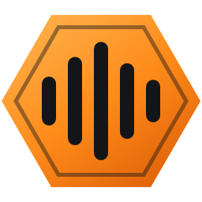

# ED Voice

**Hear your Elite Dangerous comms.** ED Voice reads the game's chat aloud while you fly: messages from other commanders, your wing and squadron, stations and NPCs. Every commander gets their own voice. The voices run **locally on your PC**, so it works offline and nothing is sent anywhere.

### ⬇️ [Download the latest version](https://github.com/Miretica/ed-voice-releases/releases/latest)

Download `EdVoiceApp-win-Setup.exe` from the latest release and run it.

---

## Features

- 🗣️ **Reads chat aloud** with natural-sounding voices (Kokoro). They run on your own computer, no cloud and no account.
- 🎭 **A voice for every commander.** New commanders automatically get their own voice and keep it. Change any voice with a right-click.
- 🛰️ **NPC and station messages** with voices per type: pirates, police, stations, traders and more. Repeated phrases such as "Docking request granted." play instantly.
- 💬 **Chat view in Elite style:** each message as a card with icon, channel, sender and text, in the game's colors (wing, squadron, direct messages, hostile and police).
- 😄 **Understands chat:** `o7`, `CMDR`, numbers, times, contractions and emoticons (`:D` → "ha ha"). Danish and Norwegian messages are read with matching sounds.
- 🔇 Read aloud on or off, NPC messages on or off, volume, speed and text size.

## Requirements

- Windows 10 or 11 (64-bit)
- Elite Dangerous on the same PC
- About 400 MB of disk space for the app and the voices

## Install

1. Download **`EdVoiceApp-win-Setup.exe`** from the [latest release](https://github.com/Miretica/ed-voice-releases/releases/latest).
2. Run it. ED Voice installs **for your user account only**, with no administrator rights, and adds shortcuts to the Desktop and Start menu.
   - If the **.NET 10 Desktop Runtime** isn't installed yet, the setup downloads it from Microsoft and installs it first. This step may ask for permission.
3. Start ED Voice and click **Download voices** (about 350 MB, once). Until then the built-in Windows voice is used.
4. Start Elite Dangerous. Messages appear and are read aloud as they arrive.

### "Windows protected your PC"?

ED Voice isn't code-signed yet, so Windows SmartScreen may warn about the installer. Click **More info → Run anyway**. Only download ED Voice from this page.

## Privacy

- ED Voice only **reads** the journal files that Elite Dangerous writes for third-party tools (`Saved Games\Frontier Developments\Elite Dangerous`). It never changes them.
- All speech is generated **on your PC**. Chat messages never leave your computer.
- The app only uses the internet to download the voice model once, from the official [sherpa-onnx release on GitHub](https://github.com/k2-fsa/sherpa-onnx/releases/tag/tts-models). The installer may also download the .NET runtime from Microsoft.

## Uninstall

Windows **Settings → Apps → Installed apps → ED Voice → Uninstall**. This removes the app, the downloaded voices and the cache. Your settings and per-commander voices are kept in `%APPDATA%\EdVoice`; delete that folder too if you want everything gone.

## Known limitations

- The voices are English. Danish and Norwegian messages are pronounced with matching sounds, but with an English accent. Other scripts, such as Cyrillic, aren't read aloud.
- Invented commander names are pronounced from their spelling. You can set how a name is pronounced under **Voices… → Spoken as**.

## Feedback

Found a bug or have an idea? Please open an [issue](https://github.com/Miretica/ed-voice-releases/issues). For problems, include the version (shown under **About**) and what happened.

## License

ED Voice is © 2026 Oleksii Miretskyi, released under the MIT License. It uses third-party components, including sherpa-onnx and the Kokoro-82M voice model (Apache-2.0), NAudio and Velopack (MIT). The full license texts and notices are included in the app under **About**.

*Elite Dangerous is a trademark of Frontier Developments plc. ED Voice is an unofficial, fan-made tool and is not affiliated with or endorsed by Frontier Developments.*